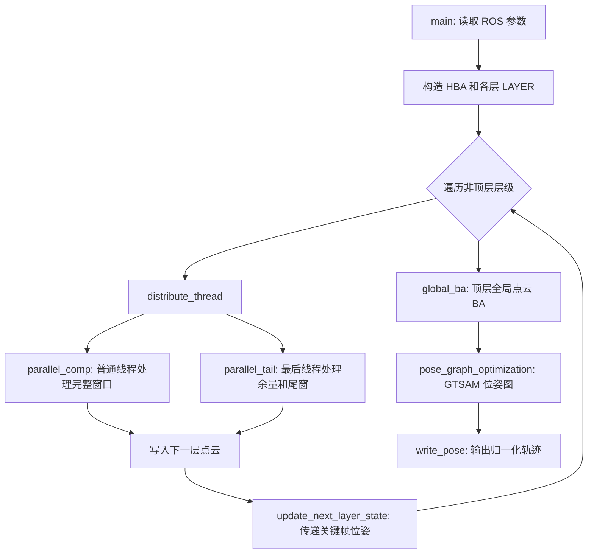

# HBA 工程代码阅读指南

本文按“程序入口 -> 分层处理 -> 点云约束 -> 位姿图优化”的顺序梳理工程，帮助从主流程逐步进入细节。算法实现位于 `source/` 和 `include/`；`launch/` 提供 ROS 参数和节点入口。

## 1. 工程结构

```text
HBA/
├── source/
│   ├── hba.cpp             # HBA 主节点：分层局部 BA、顶层全局 BA、线程调度
│   ├── visualize.cpp       # 可视化节点：发布地图点云、位姿和轨迹标记
│   └── calculate_MME.cpp   # 评估节点：多线程计算局部协方差熵
├── include/
│   ├── hba.hpp             # LAYER/HBA 管理、层间状态传递、GTSAM 位姿图
│   ├── ba.hpp              # 八叉树平面约束、Hessian 计算和 LM 位姿优化
│   ├── tools.hpp           # SO(3)、位姿状态、体素索引、统计量和降采样工具
│   └── mypcl.hpp           # PCD、位姿文件、点云变换与拼接工具
├── launch/
│   ├── hba.launch          # 启动 HBA 主节点
│   ├── visualize.launch    # 启动地图可视化
│   └── MME_evaluate.launch # 启动 MME 评估
├── rviz_cfg/               # RViz 显示配置
└── CMakeLists.txt          # 定义三个可执行目标及其依赖
```

## 2. 从哪里开始读

建议按下面顺序阅读，先建立数据流，再查看矩阵推导：

1. `source/hba.cpp` 的 `main()`：节点参数、各层执行顺序。
2. `include/hba.hpp` 的 `HBA` 构造函数和 `LAYER::init_parameter()`：层数、窗口和线程任务如何确定。
3. `source/hba.cpp` 的 `distribute_thread()`、`parallel_comp()`、`parallel_tail()`：每个窗口如何读取点云并产生下一层点云。
4. `source/hba.cpp` 的 `cut_voxel()` 与 `include/ba.hpp` 的 `OCTO_TREE_NODE`：点如何聚合成平面约束。
5. `include/ba.hpp` 的 `VOX_HESS`、`VOX_OPTIMIZER::damping_iter()`：残差、Hessian 和位姿更新。
6. `source/hba.cpp` 的 `global_ba()` 与 `include/hba.hpp` 的 `pose_graph_optimization()`：全局细化和最终轨迹更新。

## 3. 主程序调用结构



`main()` 从 ROS 私有参数读取 `total_layer_num`、`data_path`、`thread_num` 和 `pcd_name_fill_num`。`HBA` 用输入的 `pose.json` 初始化第一层，再根据前一层的窗口划分计算后续层的位姿数量和数据目录。

对于每个非顶层，主线程分发并等待窗口任务完成，然后调用 `update_next_layer_state()`，从已优化位姿中按窗口步长抽取下一层初值。所有局部层结束后，对最后一层运行 `global_ba()`，再用各层约束构造 GTSAM 位姿图，并把最终轨迹写回数据目录中的 `pose.json`。

## 4. HBA 的核心数据流

### 输入

- `data_path/pose.json`：初始位姿，每行格式为平移 `tx ty tz` 加四元数 `qw qx qy qz`。
- `data_path/pcd/`：首层使用的逐帧点云。
- ROS 参数指定层数、线程数和 PCD 帧编号格式。

### 一个局部窗口

`WIN_SIZE` 是每个完整窗口包含的帧数，`GAP` 是相邻窗口起点的间隔。当前默认值为 10 和 5，所以相邻完整窗口会共享帧。

处理步骤如下：

1. 从当前层位姿和点云集合中取得窗口帧；第一层从磁盘读取 PCD，更高层读取前一层生成的点云。
2. 将每帧点云按配置降采样；通过 `cut_voxel()` 使用当前位姿把点变换到世界坐标，按空间体素聚合。
3. 对每个体素的八叉树执行 `recut()`：检查点数和协方差特征值，识别平面，或继续细分。
4. 平面叶节点进入 `VOX_HESS`，计算跨帧几何残差及其导数；按残差剔除离群体素。
5. `VOX_OPTIMIZER::damping_iter()` 解带阻尼的正规方程，更新窗口内旋转和平移；残差变化足够小时提前结束。
6. 将窗口里的点云变换到窗口首帧坐标系，合并、降采样，存为下一层的一帧点云。
7. 保存窗口 Hessian 摘要，供后续位姿图优化使用。

末尾无法组成完整窗口时，由 `parallel_tail()` 用 `last_win_size` 处理短尾窗。`parallel_comp()` 只处理分给普通线程的完整窗口；最后一个线程还承担最后一段完整窗口和可能存在的短尾窗。

### 分层含义

较粗层把多个相邻帧汇总成较少的关键帧/点云，从而降低后续 BA 的规模。每层的位姿是下一层的初始值；最终顶层 BA 优化粗尺度地图，位姿图再把顶层约束传回原始轨迹的节点集合。

## 5. 几个核心模块

### `include/tools.hpp`

- `IMUST`：保存旋转矩阵、位置、速度、偏置和重力；本工程的 LiDAR BA 主要更新旋转和平移。
- `Exp()` / `Log()`：SO(3) 旋转向量与旋转矩阵之间的指数/对数映射。
- `VOXEL_LOC`：三维整数体素坐标，作为哈希表键。
- `downsample_voxel()`：每个非空体素用点坐标均值替代原始点。
- `VOX_FACTOR`：保存 `P = sum(p p^T)`、`v = sum(p)` 和点数 `N`，可合并不同帧的统计量并恢复协方差。

### `include/ba.hpp`

- `VOX_HESS`：保存有效平面体素并计算最小协方差特征值残差、Jacobian 和 Hessian。
- `OCTO_TREE_NODE`：八叉树节点状态为 `UNKNOWN`、`MID_NODE` 或 `PLANE`；`recut()` 判定是否为平面或递归细分，`tras_opt()` 收集有效平面约束。
- `VOX_OPTIMIZER`：并行累加体素正规方程，按残差去除离群体素，并用 Levenberg-Marquardt 阻尼迭代更新各帧位姿。

这里的平面误差直观上是点云在平面法向上的离散程度：协方差最小特征值越小，点越接近平面。

### `include/hba.hpp`

- `LAYER`：保存一层的位姿、点云、窗口/尾窗尺寸、线程划分、Hessian 和优化参数。
- `HBA`：构造所有层，负责将上一层关键帧位姿传到下一层，以及生成 GTSAM 因子图。
- `pose_graph_optimization()`：首个位姿作为先验；局部层与顶层 Hessian 摘要转换为相对位姿因子的对角噪声，再由 iSAM2 求解。

### `include/mypcl.hpp`

负责 PCD 读写、位姿文本读写、刚体变换和点云拼接。`write_pose()` 会把轨迹变换到首帧坐标系，并且会直接修改传入的 `pose_vec`，调用前应留意这一点。

## 6. `ref(layer)` 是什么

线程构造大致如下：

```cpp
layer.mthreads[i] = new thread(parallel_comp, ref(layer), i, ref(next_layer));
```

`parallel_comp` 的参数是 `LAYER&`。`std::thread` 默认会按值保存传入参数；`std::ref(layer)` 用 `std::reference_wrapper` 包装对象，告诉线程入口以引用方式接收这个已有的 `LAYER`，避免复制整个层对象（其中还包含位姿、点云和容器）。`ref(next_layer)` 同理。

线程只在 `distribute_thread()` 的 `join()` 返回后才算完成，因此当前流程依赖“工作线程不越过 `join()` 继续访问这些层对象”。每个线程写入不同窗口索引；若改动线程分工或共享数据写入方式，需要重新检查是否有索引重叠和数据竞争。

## 7. 其他可执行节点

- `source/visualize.cpp`：读取 `pose.json` 和逐帧 PCD，把单帧点云变换到地图坐标并发布 ROS 点云、位姿数组和 RViz Marker。对应 `launch/visualize.launch`。
- `source/calculate_MME.cpp`：用 KD 树查询局部邻域，根据协方差矩阵行列式计算局部熵，再汇总均值和标准差。对应 `launch/MME_evaluate.launch`。
- `CMakeLists.txt` 定义 `hba`、`visualize_map`、`calculate_MME` 三个可执行目标。

## 8. 阅读与调试提示

- 先确认 `data_path` 目录下的位姿数量与 PCD 帧编号对应；`pcd_name_fill_num` 是编号最小宽度，例如值为 5 时帧 1 对应 `00001.pcd`。
- `WIN_SIZE`、`GAP` 会影响窗口重叠、尾窗大小、每层点云数量和线程负载，修改后要同时检查 `LAYER::init_parameter()` 的尺寸计算。
- `eigen_ratio` 控制体素平面判定；`reject_ratio` 控制按残差剔除的比例；`downsample_size` 控制输入点云密度。
- `parallel_tail()` 的计时统计针对其完整窗口循环；短尾窗代码路径单独执行。
- MME 计算中每个线程使用 `full_cloud.size() / THR_NUM` 个点；若点数不能整除线程数，最后的余数点在当前实现中不会被分配。
- 修改优化器或窗口结构时，优先分别检查小规模单层窗口、含尾窗数据和多线程分配三种情形。
